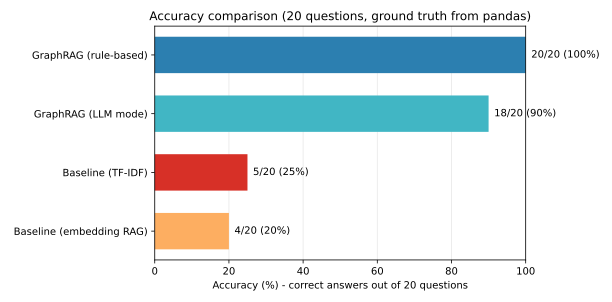
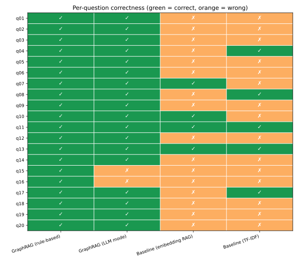

# GraphRAG Enterprise QA

A personal project by Santhosh Chakilam (data scientist). GraphRAG
question answering over ERP-style business data: build a knowledge
graph from sales tables, answer business questions by traversing the
graph, and compare against two retrieval baselines (TF-IDF and dense
embeddings).

Two modes: rule-based by default (no model download — questions are
parsed with rules, answers are extractive values from the graph), and
an opt-in LLM mode (`--llm`) where Qwen2.5-0.5B-Instruct routes each
question to an intent + entities and composes the final answer in
natural language from the graph evidence. The scored answer is always
the extractive graph value, never the generated sentence.

## Data

Northwind Traders sample data — the classic ERP-style dataset:
customers, orders, order details, products, suppliers, employees,
categories, shippers. The CSVs live in `data/` (220 KB total) and come
from the public Northwind CSV mirror in the
[graphql-compose examples repo](https://github.com/graphql-compose/graphql-compose-examples/tree/master/examples/northwind/data/csv).

**Northwind is a sample dataset, NOT real SAP data.** Nothing here
touches SAP systems, S/4HANA, or SuccessFactors, and no claim is made
about SAP data. It is used because its schema looks like ERP data
(orders, products, suppliers, employees) and it is small enough to
run anywhere.

## What is built

**Knowledge graph** (`src/graphrag_enterprise_qa/graph_build.py`):
a NetworkX `MultiDiGraph` with 1,047 nodes and 4,799 edges.

| Node type | Count | Edge type | Count |
|---|---|---|---|
| Customer | 91 | PLACED (Customer → Order) | 830 |
| Product | 77 | CONTAINS (Order → Product) | 2,155 |
| Supplier | 29 | SUPPLIED_BY (Product → Supplier) | 77 |
| Employee | 9 | MANAGED_BY (Order → Employee) | 830 |
| Category | 8 | IN_CATEGORY (Product → Category) | 77 |
| Order | 830 | SHIPPED_BY (Order → Shipper) | 830 |
| Shipper | 3 | | |

Order lines carry `line_total_cents` (integer cents — money is never
summed in floats, so totals are exact to the cent).

**GraphRAG QA** (`src/graphrag_enterprise_qa/qa.py`): rule-based
entity extraction (names matched against the graph), intent detection
from keywords, then 1–2 hop traversal and aggregation. Example:
"Which supplier provides the most products in the Beverages category?"
→ find the Beverages category node → its 12 products via
`IN_CATEGORY` → their suppliers via `SUPPLIED_BY` → count → max
(Bigfoot Breweries, 3). Answers come with evidence lines describing
the traversal.

**LLM mode** (`src/graphrag_enterprise_qa/llm.py`, opt-in): the same
traversal, but Qwen2.5-0.5B-Instruct (Hugging Face, CPU, greedy
decoding) routes each question to an intent + entity names, and
composes the final answer as one natural-language sentence from the
extractive answer + evidence. The LLM output is validated against
the known intents and the graph's entity names; anything invalid
falls back to the rule-based parser. The scored answer is always the
extractive graph value — a composed sentence that drops the value is
reported, not scored.

**Baseline (TF-IDF)** (`src/graphrag_enterprise_qa/baseline.py`): every CSV row
flattened to one text chunk (3,202 chunks), TF-IDF retrieval
(top-50), and the answer extracted from those chunks only — by
counting mentions or summing numbers found in them. It shares the
question parser with GraphRAG, so the comparison isolates retrieval
vs graph traversal. It never sees the graph, so it cannot aggregate
over the full dataset.

**Baseline (embedding RAG)** (`src/graphrag_enterprise_qa/embedding_baseline.py`):
the same chunks, top-50, and answer handlers as the TF-IDF baseline,
but retrieval is dense embedding cosine similarity with
sentence-transformers all-MiniLM-L6-v2. The only difference is the
retriever, so the comparison isolates sparse vs dense retrieval.

**Evaluation** (`src/graphrag_enterprise_qa/eval.py`): 20 business
questions in `src/graphrag_enterprise_qa/questions.json`. Ground truth
is computed from the CSVs with pandas at run time — never hard-coded,
never read from either system. Money is compared to the cent, counts
exactly, lists as sets.

## How to run

```bash
python3 -m venv .venv
source .venv/bin/activate
pip install -r requirements.txt
```

On a CPU-only machine, install torch from the CPU index first
(the default wheel is CUDA and much larger):

```bash
pip install torch --index-url https://download.pytorch.org/whl/cpu
pip install -r requirements.txt
```

```bash
python run_eval.py                      # fast path: rule-based + TF-IDF only
python run_eval.py --embedding          # + dense embedding baseline
python run_eval.py --llm --embedding    # + LLM mode; the reported numbers
python make_visuals.py                  # regenerate the SVG charts + HTML report in results/
python verify_results.py                # re-runs the fast path + embedding, checks results.json + README + visuals
python verify_results.py --llm          # also re-runs the LLM mode
python -m pytest tests/ -q              # unit tests (mocked models); integration tests need cached models
```

`--llm` downloads Qwen2.5-0.5B-Instruct (~1GB, once) into the
Hugging Face cache; `--embedding` downloads all-MiniLM-L6-v2
(~90MB, once). Nothing is stored in the repo. LLM mode takes several
minutes on CPU (40 generations over 20 questions). Enable it with
`GRAPHRAG_USE_LLM=1` in code, or `--llm` on the command line.

Try a single question:

```bash
python -c "
import sys; sys.path.insert(0, 'src')
from graphrag_enterprise_qa.graph_build import build_graph
from graphrag_enterprise_qa.qa import answer_question
g, idx = build_graph()
print(answer_question('Which employee handled the most orders in 1997?', g, idx)[0])
"
```

## Results

Measured by `python run_eval.py --llm --embedding` on 20 questions.
Every number below comes from a run of the code — see `results.json`
for the full per-question output, `verify_results.py` to reproduce
it, and `results/report.html` for the full report with charts.

- GraphRAG: 20/20 = 100.0%
- GraphRAG (LLM mode): 18/20 = 90.0%
- Baseline (TF-IDF): 5/20 = 25.0%
- Baseline (embedding RAG): 4/20 = 20.0%





| # | Question | Ground truth | GraphRAG | GraphRAG (LLM mode) | Baseline (embedding RAG) | Baseline (TF-IDF) |
|---|---|---|---|---|---|---|
| q01 | Which supplier provides the most products in the Beverages category? | Bigfoot Breweries | ✓ | ✓ | ✗ Exotic Liquids | ✗ (no answer) |
| q02 | Which supplier provides the most products in the Seafood category? | Svensk Sjöföda AB | ✓ | ✓ | ✗ (no answer) | ✗ New England Seafood Cannery |
| q03 | Which employee handled the most orders in 1997? | Margaret Peacock | ✓ | ✓ | ✗ Janet Leverling | ✗ Janet Leverling |
| q04 | Which employee handled the most orders in 1996? | Margaret Peacock | ✓ | ✓ | ✗ Janet Leverling | ✓ |
| q05 | What is the total revenue from the Beverages category? | $267,868.18 | ✓ | ✓ | ✗ $19,896.19 | ✗ $14,499.39 |
| q06 | What is the total revenue from the Dairy Products category? | $234,507.29 | ✓ | ✓ | ✗ $47,715.20 | ✗ $14,086.87 |
| q07 | Which customer placed the most orders? | Save-a-lot Markets | ✓ | ✓ | ✓ | ✗ (no answer) |
| q08 | Which customer generated the most revenue? | QUICK-Stop | ✓ | ✓ | ✗ Save-a-lot Markets | ✓ |
| q09 | Which product generated the highest revenue? | Côte de Blaye | ✓ | ✓ | ✗ Tarte au sucre | ✗ Konbu |
| q10 | Which category has the most products? | Confections | ✓ | ✓ | ✓ | ✗ Dairy Products |
| q11 | Who is the supplier of the product Chai? | Exotic Liquids | ✓ | ✓ | ✓ | ✓ |
| q12 | How many products does the supplier Exotic Liquids supply? | 3 | ✓ | ✓ | ✗ 2 | ✗ 2 |
| q13 | How many orders did the customer Alfreds Futterkiste place? | 6 | ✓ | ✓ | ✓ | ✓ |
| q14 | How many orders did United Package ship? | 326 | ✓ | ✓ | ✗ 49 | ✗ 49 |
| q15 | What is the total freight charged by Federal Shipping? | $20,512.51 | ✓ | ✗ (no answer) | ✗ $2,711.75 | ✗ $1,209.61 |
| q16 | Which products are in the Seafood category? | Boston Crab Meat, Carnarvon Tigers, Escargots de Bourgogne, Gravad lax, Ikura, Inlagd Sill, Jack's New England Clam Chowder, Konbu, Nord-Ost Matjeshering, Rogede sild, Röd Kaviar, Spegesild | ✓ | ✗ Confections | ✗ (no answer) | ✗ Boston Crab Meat |
| q17 | How many customers are based in Germany? | 11 | ✓ | ✓ | ✗ 10 | ✓ |
| q18 | How many orders were placed in 1998? | 270 | ✓ | ✓ | ✗ 15 | ✗ 50 |
| q19 | What is the average order value? | $1,525.05 | ✓ | ✓ | ✗ $821.52 | ✗ $241.68 |
| q20 | How many products are discontinued? | 8 | ✓ | ✓ | ✗ 3 | ✗ 3 |

### Reading the result honestly

The baselines are not useless — TF-IDF gets 5/20 and embedding RAG
4/20, and all of those are simple single-hop lookups (who supplies
Chai, how many orders one customer placed, how many customers are in
Germany). Where both fail is aggregation: revenue, freight, and counts
over the whole dataset. Their top-50 retrieval only ever sees a
sample, so they undercount (Beverages revenue $14,499 TF-IDF /
$19,896 embedding vs the true $267,868; 49 of United Package's 326
orders; 50 of 1998's 270 orders) or answer from a sample (Janet
Leverling instead of Margaret Peacock for 1997). Dense retrieval does
not fix this: it scores slightly worse than TF-IDF here (4/20 vs
5/20), because the failure is retrieval scope, not retrieval quality
— on q16 it retrieved no chunks mentioning 'Seafood' at all and
returned no answer.

LLM mode (Qwen2.5-0.5B-Instruct) scores 18/20. The model routed 10
of the 20 questions itself and fell back to the rule-based parser for
the other 10. Its two misses show the failure modes honestly: on q15
the model produced a parse the handler could not answer ("I don't
know"), and on q16 it picked a valid but wrong intent
(`category_most_products` instead of `list_products_category`) and
answered "Confections" — then composed a confident wrong sentence,
"Confections are a product in the Seafood category." The 0.5B model
is the smallest usable size; a larger model would route better, and
the fallback is what keeps the score at 18 instead of lower. The
composed answers stated the scored value in 18 of 20 cases.

GraphRAG is 20/20 on this set, but that number needs its context:
the 20 questions were written to cover the intents the rule-based
parser supports (supplier/product/employee/customer/revenue/counts).
It is a closed question set, not open-ended QA — a question phrased
outside the covered intents returns "I don't know". The 100% says
the graph traversal is correct for these question shapes; it does
not say the system understands arbitrary business questions.

## Honest limits

- **In-memory NetworkX only.** There is no Neo4j server, no
  persistent graph store, and no Cypher. The graph is rebuilt from
  the CSVs on every run. It fits this dataset (1,047 nodes); it
  would not fit a production ERP database.
- **Rule-based parsing by default, small LLM in LLM mode.** Intent
  comes from keyword rules and entity names matched against the
  graph. In LLM mode a 0.5B instruction-tuned model routes the
  question; it is the smallest usable model and it can mis-route —
  the eval reports how often it fell back to the rules. Paraphrases
  outside the covered intents are not understood in either mode.
- **The LLM composes, it does not compute.** In LLM mode the model
  writes the final sentence, but the scored value always comes from
  graph traversal. The eval reports how many composed sentences
  actually state the value.
- **Small sample dataset.** Northwind has 830 orders and 77 products.
  Nothing about scale, latency at production size, or real ERP data
  quality is demonstrated.
- **Retrieval baselines are simple by design.** Top-50 TF-IDF and
  top-50 dense embeddings over flattened rows; a stronger baseline
  (larger k, hybrid retrieval, SQL generation) would score higher.
  The comparison shows the graph's advantage on aggregation, not a
  ceiling for retrieval.
- **Closed question set.** The 20 questions cover the intents the
  parser supports. A question outside them returns "I don't know".

## Project layout

```
graphrag-enterprise-qa/
├── README.md
├── requirements.txt
├── run_eval.py            # run the eval, write results.json [--llm] [--embedding]
├── verify_results.py      # re-run the eval, check results.json + README + visuals [--llm]
├── make_visuals.py        # regenerate results/*.svg + results/report.html from results.json
├── results.json           # measured results (generated by run_eval.py --llm --embedding)
├── results/               # accuracy_comparison.svg, per_question_correctness.svg, report.html (text only)
├── data/                  # Northwind CSVs (8 tables, 220 KB)
├── src/graphrag_enterprise_qa/
│   ├── data.py            # CSV loading + name indexes
│   ├── graph_build.py     # CSVs -> NetworkX MultiDiGraph
│   ├── qa.py              # GraphRAG: parse + traverse + answer (rule-based)
│   ├── llm.py             # LLM mode: Qwen2.5-0.5B-Instruct routing + composing
│   ├── baseline.py        # TF-IDF retrieval baseline
│   ├── embedding_baseline.py  # dense embedding retrieval baseline
│   ├── eval.py            # pandas ground truth + scoring
│   └── questions.json     # the 20 eval questions
└── tests/                 # pytest tests (mocked models; integration tests need cached models)
```
